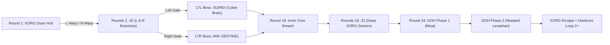

# ARKANOID II: REVENGE OF DOH
### Browser Arcade & Evolved Edition

> A zero-dependency **TypeScript + HTML5 Canvas 2D + WebGL2 + Web Audio API** recreation and modern evolution of Taito's 1987 arcade classic ***Arkanoid: Revenge of DOH***.
> Runs at native refresh rates with fixed `240Hz` swept physics, procedural graphics, GLSL CRT/bloom shaders, and a YM2151-inspired FM synthesizer — compiling down to a single standalone `dist/index.html`.

---

## Highlights

- **64-Stage Branching Campaign (34 Rounds)**: Clear a sector to open both **Left** and **Right Warp Gates** with live destination previews, routing through a 64-node binary DAG tracked on an interactive **XORG Sector Map**.
- **Two Rulesets — Switch Anytime (`Tab` or DIP-Switches)**:
  - **Evolved Arcade+ (Default)**: 1-slot **Reserve Capsule Bay**, non-destructive upgrade stacking (**Chassis / Weapon / Ball** slots), **EMP Repulsor Wave**, **Magnetic Curve**, **Kinetic Spin**, **Ricochet Combo** (`1.1x–5.0x`), **20s Stalemate Orbital Breaker**, **Mercy Shield**, and **Tactical Rewind**.
  - **Classic 1987 Purist**: Faithful arcade rules with single-slot capsule replacement, 7-zone discrete deflection angles, lethal DOH fireballs, and zero modern crutches.
- **Complete 14-Capsule Arsenal & Full Brick Roster**: All classic + *Revenge of DOH* capsules (`E, L, C, S, B, D, P, M, T, I, N, R, ?, G`), multi-hit Silver bricks, **6-second Regenerating Notched Silver bricks**, Gold bricks (breakable by Mega Ball or 6 Hyper-Pierce Laser hits in Evolved), and **Moving Bricks**.
- **Multi-Phase Boss Encounters**: Route-dependent Round 17 Mid-Bosses (**Suirei** on `17L`, **Ark-Sentinel** on `17R`) with shielded/open core phases, plus the Round 34 two-phase showdown against **DOH** (Moai Monument → Mutated Bio-Leviathan with regenerating tentacles).
- **6 Playable Modes**:
  1. **1P Campaign** (with skippable MIXTEC → XORG intro & Hardcore Loop 2+)
  2. **2P Co-Op (Simultaneous)** (P1 Mouse/Keyboard + P2 Keyboard/Gamepad, independent `1UP`/`2UP` scoring)
  3. **2P Arcade (Alternating)** (classic turn-based rivalry with independent saved boards & stage progress)
  4. **Boss Rush** (*Suirei* → *Ark-Sentinel* → *DOH*)
  5. **XORG Breach (Roguelite)** (procedural floors, boss anomalies every 5th floor, draft from 12 permanent Vaus Tech Augments)
  6. **64-Stage Sector Select** (interactive map with live stage thumbnails + Practice launch)
- **Arkanoid II Construction Set**: Built-in `13 × 22` level studio with **Mirror X**, moving brick rails, guaranteed capsule drops, `.json` import/export, local save slots, 1-click Playtest, and **shareable `?level=` Base64 URLs**.
- **WebGL2 Post-Processing (`F2`) & Procedural FM Audio**: Live toggle between **HD Neon** (multi-tap bloom) and **1987 Trinitron CRT** (scanlines, aperture grille, optional barrel curvature, chromatic pulse), paired with procedural FM/PSG SFX and Zuntata-inspired music tracks.

---

## Branching Sector Progression



---

## Quick Start

**Requirements:** Node.js 18+

```bash
git clone https://github.com/mvsoares/arkanoid-ii-revenge-of-doh.git
cd arkanoid-ii-revenge-of-doh
npm install
npm run dev
```

Open `http://localhost:5173` in your browser.

### Standalone Single-File Build

```bash
npm run build
```

This type-checks with `tsc --noEmit` and bundles everything into a single self-contained **`dist/index.html`** (via `vite-plugin-singlefile`) that can be served with `npm run preview` or opened directly via `file://` with zero external assets.

### Running on a Remote VM (SSH)

If you cloned onto a headless/remote VM and want to play in your local browser, forward port `5173` so `localhost` and Pointer Lock work cleanly:

```bash
# On your local machine:
ssh -L 5173:localhost:5173 <user>@<vm-host>

# On the remote VM:
npm run dev
```

Then open `http://localhost:5173` locally. *(Alternatively, use `npm run dev -- --host` or `scp` `dist/index.html` locally.)*

---

## Controls

| Action | Player 1 (Mouse / Keyboard) | Player 2 (2P Co-Op) | Gamepad |
| :--- | :--- | :--- | :--- |
| **Steer Vaus II** | Mouse (Pointer Lock / Cursor) or `A` / `D` / `◄` `►` | `◄` `►` or `J` / `L` | Left Stick / D-Pad |
| **Precision Move** | Hold `Shift` | Hold `Right Shift` | — |
| **Launch / Fire Laser** | `Left Click` / `Space` / `Z` / `W` | `▲` / `Enter` / `I` | `A` / `RT` |
| **Deploy Reserve Capsule** | `Right Click` (quick tap) / `R` | `/` / `O` | `X` |
| **EMP Repulsor Wave** | `X` / `F` *(or `Right Click` tap if bay empty)* | `▼` / `K` | `B` |
| **Magnetic Curve** | Hold `Right Click` / `Q` / `Middle Click` (attract), `E` (repel) | Hold `U` (attract) | `LB` / `RB` |
| **Tactical Rewind** | Hold `Backspace` *(Evolved)* | — | — |
| **Insert Coin / Mode** | `C` or `5` (Coin) • `Tab` (Evolved/Purist on Title) | — | — |
| **Video / Pause** | `F2` (HD Neon ↔ CRT 1987) • `P` / `Esc` (Pause) | — | — |

Touchscreens are also supported with a lower steering strip and quick buttons for **Reserve**, **EMP**, and **Pause**.

---

## 14-Capsule Arsenal

| Pill | Name | Effect |
| :---: | :--- | :--- |
| **`E`** | **ENLARGE** | Expands Vaus II width (`1.48x`, stacks up to `1.92x` in Evolved) |
| **`L`** | **LASER** | Twin plasma cannons (stacks to **Hyper-Pierce Laser** capable of overloading Gold bricks) |
| **`C`** | **CATCH** | Magnetizes Vaus II to catch, aim, and release the Energy Ball on demand |
| **`S`** | **SLOW** | Decelerates active balls by ~32% and resets speed escalation |
| **`B`** | **BREAK** | Opens the right-wall **Bonus Warp Exit** (`+10,000 pts` & instant clear) |
| **`D`** | **DISRUPTION** | Splits the Energy Ball into 3 simultaneous balls |
| **`P`** | **PLAYER** | Awards `+1` Extra Vaus II life |
| **`M`** | **MEGA BALL** | Supercharges balls to plow straight through Colored, Silver, Regen & Gold bricks |
| **`T`** | **TWIN VAUS** | Deploys a synchronized dual-pod Twin Vaus chassis |
| **`I`** | **ILLUSION** | High-speed movement leaves solid holographic after-images that deflect balls |
| **`N`** | **INFINITE SPLIT** | 3-ball split that automatically re-splits whenever 1 or 2 balls drain |
| **`R`** | **REDUCE (2X)** | Hazard risk/reward: shrinks Vaus II to `0.6x` width, **doubles all score (`2X`)** |
| **`?`** | **MYSTERY** | Jackpot: *8-Ball Frenzy*, *12s Auto-Vulcan*, *Thunder Clear*, *Barrier +3*, or *Golden Pinata Swarm* |
| **`G`** | **GOLD JACKPOT** | **Golden Overload**: Barrier Shield +3 + Mega Balls + Hyper Auto-Vulcan |

---

## Project Architecture

```text
src/
├── main.ts                    # Application bootstrap, rAF loop, ?level= URL loader
├── types.ts                   # Shared TypeScript interfaces for entities, stages & snapshots
├── constants.ts               # 960×768 layout, 13×22 grid, brick points, capsule metadata
├── core/
│   └── input.ts               # Pointer Lock, keyboard, Gamepad API & touch input manager
├── physics/
│   └── collision.ts           # Swept circle-vs-AABB solver, Vaus bounce curves, moving bricks
├── entities/
│   └── bosses.ts              # Suirei, Ark-Sentinel & 2-phase DOH AI, shields & projectiles
├── game/
│   └── gameEngine.ts          # 240Hz fixed-timestep simulation, modes, synergies, rewind & saves
├── stages/
│   ├── stageCatalog.ts        # All 64 handcrafted campaign stages across 34 rounds
│   ├── sectorGraph.ts         # Binary Left/Right Warp DAG, 12 Roguelite augments & generator
│   └── codec.ts               # UTF-8 Base64url (?level=...) & JSON stage encoder/validator
├── rendering/
│   ├── renderer.ts            # Canvas2D renderer (6 themes, bosses, HUDs, map & overlays)
│   └── postProcess.ts         # WebGL2 GLSL3 post-processing (1987 CRT & HD Neon Bloom)
├── audio/
│   └── soundEngine.ts         # Procedural Web Audio API 2-op FM + PSG synth & music sequencer
├── editor/
│   └── constructionSet.ts     # In-browser level studio with playtest, JSON & URL sharing
└── ui/
    └── dipModal.ts            # Taito/XORG DIP-Switch settings modal
```

---

## License

MIT / Personal Arcade Recreation Project. *Arkanoid: Revenge of DOH* is an original 1987 trademark of Taito Corporation; this project is an independent educational fan recreation built with 100% procedural code.
